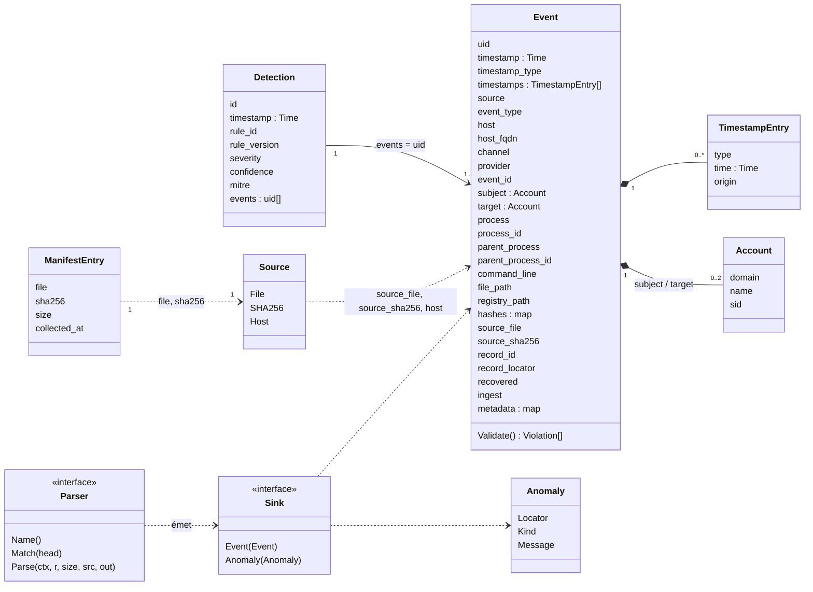

# Architecture de DFIRFlow — état au 2026-11-25

Ce document décrit le projet **tel qu'il est aujourd'hui** : ce qui est livré, ce qui est conçu
mais pas encore codé, et ce qui reste prévu. Il complète [Archi.md](Archi.md), qui décrit la
cible finale. Le sens de chaque donnée est détaillé dans
[dictionnaire-donnees.md](dictionnaire-donnees.md) ; les décisions d'architecture sont consignées
dans [adr/](adr/).

États utilisés : **Livré** (codé, testé, fusionné dans `dev`) · **Codé** (codé et testé sur sa
branche, pas encore fusionné) · **Conçu** (spec et plan validés,
pas encore codé) · **Prévu** (pas encore spécifié).

---

## 1. Vue d'ensemble

DFIRFlow est un binaire Go unique, sans dépendance externe, qui fonctionne hors ligne sur une
station d'analyse Windows ou Linux. Il prend en entrée des artefacts Windows (journaux EVTX, $MFT,
registre…) et produit une chronologie, des détections et un rapport, en garantissant la chaîne de
preuve.

```text
             Poste Windows / image disque / sorties d'outils tiers
                                    │
          ┌─────────────────────────┴─────────────────────────┐
          ▼                                                   ▼
  collect (004, livré)                              import (011, prévu)
  copie + SHA-256 + origine                         lit KAPE, Hayabusa…
          │                                         (n'exécute jamais rien)
          ▼                                                   │
  ┌──────────────────── DOSSIER DE CAS (002, livré) ──────────┴────────┐
  │  evidence/  (lecture seule)  ◀── manifeste SHA-256, journal        │
  └───────────────────────────────┬────────────────────────────────────┘
                                  ▼
                    ingest (005, livré) : vérifie l'empreinte,
                    choisit le parser par signature
                                  ▼
                    Parser (contrat 003, livré) : EVTX 005 (livré),
                    USN 007, registre 008, $MFT 009, Prefetch 010 (prévus)
                                  │  Event + Anomaly
                                  ▼
                    Validation centralisée (003, livré)
                                  │  JSONL canonique
                                  ▼
                    normalized/  (005, livré) : événements + anomalies
                                  │
              ┌───────────────────┼────────────────────┐
              ▼                   ▼                    ▼
     timeline/ (006, codé)   detections/ (012, prévu)  corrélation (prévu)
              └───────────────────┼────────────────────┘
                                  ▼
                     reports/ : HTML, SQLite, JSONL (prévu)
```

Tout passe par la **CLI** (spec 001), qui ne contient aucune logique métier : elle valide les
arguments et appelle les packages internes.

---

## 2. Ordre de développement (tranche verticale EVTX)

| Spec | Sujet | État |
|---|---|---|
| 001 | Grammaire de la CLI (10 commandes, aide, codes de sortie) | Livré |
| 002 | Dossier de cas, manifeste, vérification d'intégrité, journal | Livré |
| 003 | Modèle `Event`, `Detection`, contrat `Parser`, JSONL canonique | Livré |
| 004 | `collect` : copie des journaux EVTX dans le cas, métadonnées d'origine | Livré |
| 005 | Parser EVTX natif (fork interne, ADR-002) + `ingest` | Livré |
| 006 | `timeline` | Codé |
| 007–012 | USN, registre, $MFT, Prefetch, importers, détection | Prévu |

---

## 3. Décisions d'architecture

| Décision | Date | Résumé | Référence |
|---|---|---|---|
| Approche hybride, natif d'abord | 2026-10 | Artefacts du cœur décodés en Go ; sorties d'outils tiers seulement importées, jamais exécutées | `etude-existant.md` §6–7, constitution II |
| ADR-002 : parsers natifs | 2026-11-25 | EVTX : fork interne de `Velocidex/evtx` v0.2.0 (Apache-2.0), sans la résolution des messages ni dépendance externe, corrigé (pertes silencieuses, bornes, types hexadécimaux) | [adr/ADR-002-parsers-natifs.md](adr/ADR-002-parsers-natifs.md) |
| Table de correspondance EVTX déclarative | 2026-11-25 | Le type d'événement et les champs extraits viennent d'un fichier JSON embarqué, pas du code | [guide-table-evtx.md](guide-table-evtx.md), spec 005 FR-011 |
| Collecte live NTFS (DF-13) | 2026-11-25 | Reportée ; un fichier verrouillé est rapporté `FAILED` | spec 004 FR-012 |
| Décodage EVTX parallèle (DF-18) | 2026-11-25 | Reporté à l'optimisation des performances (DF-37) | spec 005 FR-007 |

---

## 4. Code source

```text
cmd/dfirflow/              Livré : point d'entrée et CLI
├── main.go                   dispatch, codes de sortie, Ctrl+C (130)
├── commands.go               table des 10 commandes, options, exécution
└── flags.go                  analyse des options (une seule fois, listes, `--`)
internal/
├── case/       (casefile) Livré : dossier de cas
│   ├── case.go               Create, Open, Recorded, arborescence, case.json
│   ├── manifest.go           AddEvidence : copie + SHA-256 + origine + lecture seule
│   ├── verify.go             Verify : OK / MODIFIED / MISSING / UNTRACKED
│   └── journal.go            Log : une ligne JSON par commande
├── collector/             Livré : collecte (spec 004)
│   ├── collector.go          Collect : statuts COLLECTED / ALREADY / CONFLICT / FAILED / SKIPPED
│   ├── patterns.go           motifs d'artefacts, recherche sans casse, liens non suivis
│   ├── origin*.go            horodatages d'origine par plateforme (build tags)
│   └── locked*.go            fichier verrouillé sous Windows
├── normalizer/            Livré : modèle d'événement
│   ├── event.go              Event, Account, TimestampEntry, listes fermées
│   ├── time.go               Time : horodatage JSON à 6 décimales
│   ├── normalize.go          UID, NormalizeHost, NewAccount, FormatHex
│   ├── validate.go           Validate → []Violation
│   ├── detection.go          Detection, DetectionID
│   └── jsonl.go              Encoder, ReadEvents, ReadDetections, tri
├── parser/                Livré : contrat commun à tous les parsers et importers
│   ├── parser.go             Source, Anomaly, Sink, Parser, Validating
│   └── evtx/              Livré (spec 005)
│       ├── binxml/           fork de Velocidex/evtx (Apache-2.0, LICENSE + NOTICE)
│       ├── parser.go         Parser EVTX : contrat de la spec 003
│       ├── mapping.go        chargement et application de la table
│       └── mapping.json      table de correspondance EVTX (données)
├── ingest/                Livré (spec 005) : intégrité, choix du parser, écriture de normalized/
└── timeline/              Codé (spec 006) : sélection, filtres, tri externe, écriture atomique
specs/NNN-*/                  spec, plan, recherche, contrats, tâches de chaque fonctionnalité
docs/adr/                     décisions d'architecture
.specify/memory/constitution.md   9 principes non négociables
```

Dépendances : **bibliothèque standard Go uniquement** (constitution, principes I et VII). Le code
d'origine Velocidex est intégré au dépôt, ce n'est pas une dépendance de module.

Le dossier `spikes/` (code jetable des études) est ignoré par git.

---

## 5. La CLI (spec 001)

| Commande | Rôle | État |
|---|---|---|
| `case init <ID> --host --analyst [--dir]` | crée le dossier de cas | Livré |
| `case verify --case` | recalcule les SHA-256, détecte toute altération | Livré |
| `collect --case --target` | copie les journaux EVTX d'un volume dans le cas | Livré (004) |
| `ingest --case [chemins…]` | décode les preuves vers `normalized/` | Livré (005) |
| `import --case --tool <outil> <chemin>` | lit les sorties d'un outil tiers | Prévu (011) |
| `timeline --case [--from --to --source]` | chronologie filtrée vers `timeline/timeline.jsonl` | Codé (006) |
| `detect --case [--rules]` | applique les règles | Prévu (012) |
| `correlate --case` | reconstitue les chaînes d'attaque | Prévu |
| `report --case --format html,sqlite,jsonl` | produit les livrables | Prévu |
| `investigate --case --target` | enchaîne les étapes, sans logique propre ; collecte, ingère, construit la chronologie, puis s'arrête à `detect` | Partiel |

Les commandes non livrées répondent « not implemented yet », avec le code 3.

**Codes de sortie** : 0 succès · 1 échec d'exécution · 2 erreur d'usage · 3 non implémenté ·
4 échec d'intégrité (`case verify`, `ingest` sur une preuve altérée) · 130 interruption.

### `collect` (spec 004)

- Cherche `Windows/System32/winevt/Logs/*.evtx` sous la racine du volume, sans tenir compte de la
  casse, en conservant le chemin réel.
- Une ligne par fichier : `COLLECTED`, `ALREADY` (déjà au manifeste, même empreinte), `CONFLICT`
  (source différente, preuve existante intacte), `FAILED`, `SKIPPED` (lien ou fichier spécial).
- Refuse un cas situé sous la cible ; ne modifie jamais la cible.
- Entrée `collect` dans `case.log` : cible, compteurs, liste `problems`.

### `ingest` (spec 005, livré)

- Traite les preuves du manifeste (toutes, ou celles désignées) ; reconnaît un EVTX à sa signature.
- Vérifie l'empreinte de chaque preuve avant de la décoder : une preuve altérée est `ALTERED`
  (code 4) et n'est pas ingérée.
- Écrit `normalized/<chemin de la preuve>.jsonl` (événements) et `.anomalies.jsonl` (anomalies),
  de façon atomique ; une relance produit des fichiers identiques.
- Résumé : statut par preuve, nombres d'événements et d'anomalies, part des événements `other` et
  les dix (canal, EventID) non classés les plus fréquents.

### `timeline` (spec 006, codé)

- Lit `normalized/<preuve>.jsonl` des seules preuves du manifeste ; les anomalies et les fichiers
  `.partial` ne sont jamais lus ; un fichier sans preuve au manifeste est signalé.
- Filtres facultatifs : `--from`, `--to` (bornes incluses, UTC par défaut, à la microseconde),
  `--source` ; chaque événement apparaît une seule fois, à son horodatage principal.
- Écrit `timeline/timeline.jsonl` dans l'ordre canonique ; la précédente n'est remplacée qu'une fois
  la nouvelle complète ; l'entrée `case.log` porte les filtres, les compteurs et le SHA-256.

---

## 6. Le dossier de cas (spec 002)

```text
<dir>/<case_id>/
├── case.json              qui, quand, quelle machine, quelle version
├── case.log               une ligne par commande exécutée (ajout seul)
├── evidence/              copies des preuves, en lecture seule (alimenté par collect)
├── parsed/                réservé, non utilisé
├── normalized/            événements et anomalies JSONL (005, livré)
├── timeline/              timeline.jsonl, chronologie JSONL (006, codé)
├── detections/            détections JSONL (012, prévu)
├── reports/               HTML / SQLite / JSONL (prévu)
└── hashes/manifest.jsonl  empreinte et origine de chaque preuve (ajout seul)
```

Garanties :
- une preuve est **copiée et hachée en une seule lecture**, puis vérifiée et mise en lecture seule ;
- chaque ligne du manifeste peut porter `origin` (spec 004) : chemin source et horodatages du
  fichier d'origine relevés avant la copie ;
- le manifeste et le journal ne font **qu'ajouter** des lignes ;
- `case verify` signale toute modification, suppression ou ajout hors outil.

---

## 7. Architecture du modèle d'événement (spec 003, livrée)

### 7.1 Structures et relations



### 7.2 Comment les structures s'enchaînent

```text
case.json.hostname ─────────────┐
manifest.jsonl {file, sha256} ──┴─▶ Source ──▶ Parser.Parse(ctx, preuve, taille, Source, Sink)
                                                      │
                     ┌────────────────────────────────┴───────────────┐
                     ▼                                                ▼
              Sink.Event(Event)                              Sink.Anomaly(Anomaly)
                     │                                       unreadable / missing / truncated
                     ▼
        Validating : Event.Validate()
           ├─ valide   ─▶ consommateur ─▶ Encoder ─▶ normalized/*.jsonl
           └─ invalide ─▶ Anomaly{kind: invalid}  (jamais ignoré en silence)

normalized/*.jsonl ─▶ ReadEvents ─▶ filtre ─▶ tri externe ─▶ timeline/timeline.jsonl (006) ─▶ règles (012)
                                                         │
                                         Detection{events: [uid…]} ─▶ detections/*.jsonl
```

### 7.3 Les identifiants : qui pointe vers quoi

| Identifiant | Calcul | Relie |
|---|---|---|
| `source_sha256` | SHA-256 de la preuve (manifeste) | événement → preuve |
| `uid` | 32 hexa de SHA-256(`source_sha256` ‖ `source_file` ‖ `record_locator`) | détection → événement |
| `id` de détection | 32 hexa de SHA-256(`rule_id` ‖ `rule_version` ‖ `uid` triés) | rapport → détection |

Ces identifiants ne dépendent que de la preuve et de la position de l'enregistrement. Un correctif
de parseur ne change donc aucun `uid`, et deux exécutions donnent les mêmes identifiants.

### 7.4 Règles de format (JSONL canonique)

- un objet par ligne, terminé par `\n`, avec `schema_version` en premier ;
- les champs sont écrits dans un ordre fixe, les clés des maps sont triées et les champs vides sont omis ;
- les horodatages sont écrits `2020-09-09T13:18:23.627952Z` : en UTC, avec exactement 6 décimales ;
- l'ordre canonique des événements est `timestamp`, puis `source_file`, `record_id` et `uid` ;
- le décodeur est strict : il refuse tout champ inconnu, toute version inconnue et toute ligne
  invalide, en indiquant le numéro de la ligne.

Contrat normatif : [specs/003-event-model/contracts/event-model.md](../specs/003-event-model/contracts/event-model.md).

---

## 8. Parser EVTX et ingestion (spec 005, livré)

```text
evidence/…/Security.evtx
        │  ingest : SHA-256 recalculé = manifeste ?  non → ALTERED (code 4)
        ▼  oui
binxml (fork Velocidex)        en-tête de fichier → chunks de 64 Kio → enregistrements → BinXML
        │                      tailles bornées, pas de panique, comptage attendu / lu par chunk
        ▼  enregistrement décodé (System + EventData/UserData typés)
parser EVTX                    canal, fournisseur, EventID, Computer, TimeCreated, en-tête
        │  table de correspondance (mapping.json) → event_type, comptes, processus, empreintes…
        ▼  normalizer.Event  /  parser.Anomaly (enregistrement perdu, tronqué, illisible)
Validating (spec 003)          événement invalide → anomalie invalid
        ▼
normalized/…/Security.evtx.jsonl   +   normalized/…/Security.evtx.anomalies.jsonl
```

- **Aucune perte silencieuse** : pour chaque journal, événements + anomalies = enregistrements
  annoncés par les en-têtes de chunk.
- **Valeurs fidèles à Windows** : `HexInt` en `0x…`, horodatages à la microseconde, horodatage
  principal = instant de l'action (`UtcTime` Sysmon) sinon `TimeCreated`.
- **`event_type` = `other`** quand l'événement n'est pas dans la table : rien n'est perdu
  (`channel`, `provider`, `event_id` et `metadata` sont conservés), seul le classement manque. Pour
  ajouter un événement, voir [guide-table-evtx.md](guide-table-evtx.md).

---

## 9. Chronologie (spec 006, codé)

```text
manifeste ─▶ normalized/<preuve>.jsonl (preuves du manifeste, dans l'ordre du manifeste)
        │  ReadEvents : décodage strict, ligne refusée → échec (fichier, numéro de ligne)
        ▼  filtre --from / --to / --source
segments triés en mémoire (64 Mio au plus) ─▶ timeline/.work-*/seg-* si nécessaire
        │  fusion par tas, 128 segments au plus par passe, octets recopiés tels quels
        ▼
timeline/timeline.jsonl.partial ─▶ SHA-256 au fil de l'écriture ─▶ renommage en timeline.jsonl
```

- **Ordre total** : `timestamp` (µs), `source_file`, `record_id`, `uid` ; le résultat ne dépend ni
  du découpage en segments ni de l'ordre des fichiers.
- **Mémoire bornée** : seuls les segments en cours de tri sont en mémoire ; les fichiers de travail
  restent dans le cas et sont supprimés en succès, en échec ou à l'interruption.
- **Une seule chronologie par cas**, remplacée à chaque exécution ; les filtres de chaque version
  sont dans `case.log`.

---

## 10. Principes qui contraignent l'architecture

| Principe | Effet concret |
|---|---|
| I. Binaire autonome | Go, bibliothèque standard uniquement, hors ligne ; code tiers intégré au dépôt plutôt qu'en dépendance |
| II. Natif d'abord | `import` lit les sorties d'outils tiers, ne les exécute jamais |
| III. Chaîne de preuve | manifeste SHA-256 et origine, preuves en lecture seule, empreinte vérifiée avant ingestion, `uid` dérivé de l'empreinte |
| IV. Reproductibilité | sorties identiques à l'octet, tri total, UTC, table de correspondance versionnée |
| V. Flux | lecture par `ReaderAt` et rappels ; anomalies obligatoires, aucune perte silencieuse |
| VI. Tests d'abord | tests et fichiers de référence avant le code ; oracles (evtx_dump, EvtxECmd) |
| VII. Licences | Apache-2.0 / MIT / BSD seulement ; projet sous Apache-2.0 ; dépendance MPL-2.0 de Velocidex retirée |
| VIII. Détection | règles déterministes, sans apprentissage automatique |
| IX. Windows-first | artefacts Windows ; rendu des valeurs aligné sur la vue XML Windows ; code propre à une plateforme isolé par build tags |

---

## 11. Points ouverts

- **Taxonomie des événements** : la liste fermée de la spec 003 compte dix types. Son
  élargissement (deux niveaux catégorie / type, alignés sur ECS ou OCSF) demandera une spec qui
  modifie le modèle 003.
- **Oracle EvtxECmd** : nécessite un environnement .NET ; ses sorties de référence seront produites
  hors CI (spec 005).
- **Collecte live** (DF-13) et **décodage parallèle** (DF-18) : reportés (cycles ultérieurs).
- **Exécutions simultanées sur un même cas** : non gérées (pas de verrou de cas) ; `ingest` et
  `timeline` supposent une seule commande à la fois.
- **Récupération d'enregistrements EVTX supprimés** (espace libre des chunks, constat C13) : non
  planifiée.
